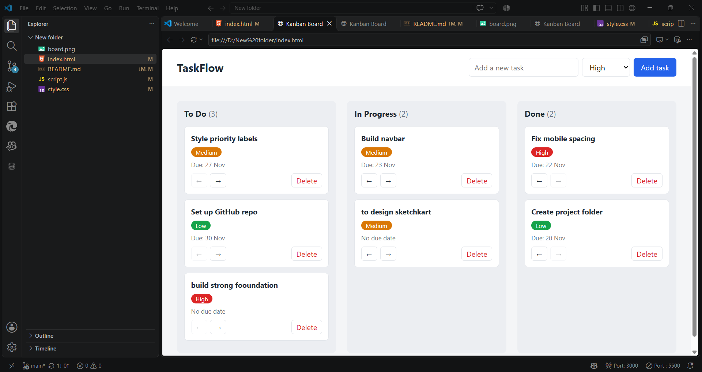

# TaskFlow – Kanban Board

Weeks 1 and 2 project for the Full Stack Engineer Virtual Internship at SkillMe.

A Kanban board built with HTML, CSS and vanilla JavaScript. Users can add tasks, move them between three columns (To Do, In Progress, Done), edit titles and delete tasks.

## Screenshots



## Features

- Add a task with a title and priority. Empty titles are rejected.
- Move tasks left or right between To Do, In Progress and Done
- Delete a task after a confirmation prompt
- Edit a task title by double-clicking it
- Column counts always match the number of cards
- Colour-coded priority labels (Low, Medium, High) using CSS variables
- Three columns side by side with CSS Grid, stacking vertically on screens narrower than 700px

## Tech Used

- HTML5 (semantic elements)
- CSS3 (Grid, custom properties, media queries)
- JavaScript (DOM manipulation, events, array methods)

## How It Works

- All tasks live in a `tasks` array of objects: `{ id, title, priority, status }`.
- A `render()` function clears each column and rebuilds the cards from that array, then updates the counts.
- Every action (add, move, delete, edit) only changes the array and then calls `render()`.
- One click listener on the board uses event delegation, with `data-id` and `data-action` attributes, to handle buttons on cards that are created dynamically.

## Project Structure

```
.
├── index.html
├── style.css
├── script.js
├── screenshots/
└── README.md
```

## How to Run

1. Clone the repository:
   ```
   git clone https://github.com/snehat1806-png/TaskFlow-Kanban-Board.git
   ```
2. Open `index.html` in your browser.

## What I Learned

- Keeping app data in an array as the single source of truth
- Writing a `render()` function that redraws the page from data
- Handling form submit and click events with `addEventListener`
- Using event delegation and `dataset` for dynamically created buttons

## Progress

- **Week 1:** Static Kanban layout with HTML and CSS
- **Week 2:** Add, move, edit and delete tasks with JavaScript

## Next Steps

- Save tasks in the browser so they persist after a refresh
- Add due dates when creating a task

## Author

Sneha Tiwari
